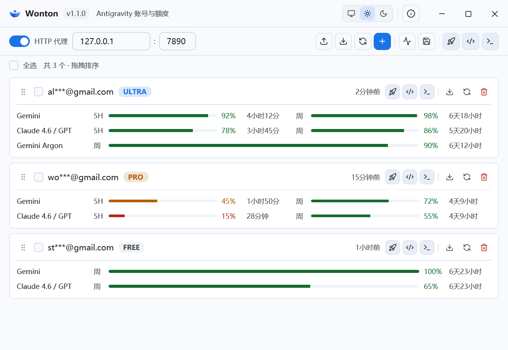
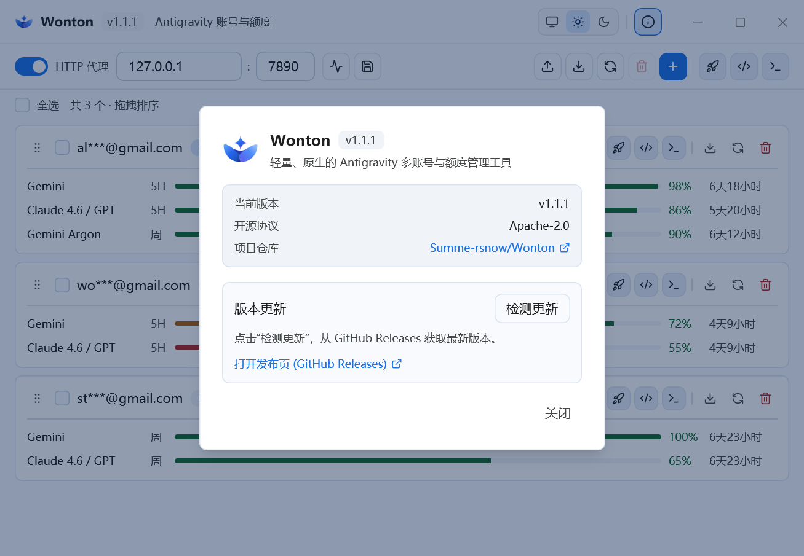

<div align="center">


# Wonton

**专为 Antigravity 打造的进程级独立代理与多账号额度管理工具**

无需修改系统代理、无需安装虚拟网卡（TUN），在进程级为 Antigravity 注入独立 HTTP 代理并一键启动，同时在一个原生窗口内完成多账号管理、实时模型额度监控与账号凭证切换。  
基于 **Rust + [NSH](https://github.com/longbridge/nsh) + [Bento](https://github.com/Summe-rsnow/Bento) `v1.0.0`** 构建，纯原生渲染，无 JavaScript 运行时开销。

<p>
  <a href="https://github.com/Summe-rsnow/Wonton/releases"></a>
  
  
  
  <a href="LICENSE"></a>
</p>

<p>
  <a href="#-进程级独立代理">独立代理</a> ·
  <a href="#-界面预览">界面预览</a> ·
  <a href="#-核心特性">核心特性</a> ·
  <a href="#-快速开始">快速开始</a> ·
  <a href="#-项目结构">项目结构</a> ·
  <a href="#-家族工具集">家族工具集</a> ·
  <a href="https://github.com/Summe-rsnow/Wonton/releases">下载 Release</a>
</p>

</div>

---

## 📸 界面预览

> 截图中的 Google 邮箱与示例数据均已做脱敏处理。

<table>
  <tr>
    <td align="center" width="50%">
      
      <br />
      <sub><b>浅色模式</b> · 顶栏版本标识、统一工具栏与多账号额度池</sub>
    </td>
    <td align="center" width="50%">
      
      <br />
      <sub><b>深色模式</b> · 自动跟随系统外观或手动切换</sub>
    </td>
  </tr>
</table>

<div align="center">
  
  <br />
  <sub><b>关于与更新检测</b> · 查看版本信息、检测 GitHub Releases 新版本并一键跳转下载</sub>
</div>

---

## 🌐 进程级独立代理

> **无需系统代理、无需虚拟网卡（TUN）** — 这是 Wonton 最核心的能力之一：让 Antigravity 稳定走指定代理的同时，完全不干扰本机其他软件的网络环境。

- **解决核心痛点**：Antigravity 底层的 `language_server`（Go 编写）默认仅读取环境变量、忽略系统代理；而客户端界面层又需要浏览器代理参数且必须绕过 `localhost` / `127.0.0.1` 回环地址（否则界面白屏）。
- **进程树精准注入**：通过 Wonton 启动 **Antigravity 经典版**、**Antigravity IDE** 或 **Antigravity CLI (`agy`)** 时，自动向该子进程树注入 `HTTP_PROXY` / `HTTPS_PROXY` / `ALL_PROXY`（大小写双份）、`NO_PROXY` 及 `--proxy-server` / `--proxy-bypass-list` 参数。
- **开箱即测即用**：主工具栏左侧即可开关 HTTP 代理、填写 `主机 : 端口`，并在输入框旁一键**测试代理连通性与延迟**、**保存代理配置**；关闭代理开关即可一键切回直连。
- **全链路统一通道**：Wonton 自身的所有网络请求（OAuth 授权、刷新令牌、额度查询、更新检测）均统一走所配代理或直连，并复用连接池与 TLS 会话。

---

## ✨ 核心特性

- **📊 多账号额度一目了然**
  - 实时展示账号订阅等级（`ULTRA` / `PRO` / `FREE`）与各模型池（`Gemini`、`Claude / GPT`、`Gemini Argon`）的 **5 小时（5H）** 与 **周（周）** 剩余额度百分比、阈值告警色与重置倒计时。
  - 支持卡片**拖拽排序**与顺序持久化，内置 **跟随系统 / 浅色 / 深色** 三种外观模式。
- **🔑 多种账号导入、导出与批量管理**
  - **网页授权**：在浏览器完成 Google OAuth 登录，通过本地回环端口自动接收回调并立即刷新额度。
  - **手动 Token & JSON 导入**：粘贴单个或多个 `refresh_token`（支持纯文本或 JSON 数组），也可直接在弹窗内点击「导入账号 JSON」选择文件。
  - **本机导入**：直接读取本机已登录 Antigravity 客户端的 `state.vscdb`，解析 protobuf 自动提取 `refresh_token`（Windows）。
  - **选中即局部操作**：勾选账号后，工具栏的**导出**与**刷新**会自动切换为针对**已选账号**（未勾选时作用于全部账号），并支持工具栏一键**批量删除**（带二次确认）。
- **🚀 多端凭证切换与启动**
  - 工具栏右侧集成 **Antigravity 经典版**、**Antigravity IDE**、**Antigravity CLI (`agy`)** 三个直达启动按钮；账号行支持一键**刷新凭证并切换账号后启动对应客户端**（自动继承进程级代理设置）。
- **🖥️ 原生桌面体验与版本更新**
  - 顶栏实时展示当前版本号，提供「关于」界面，支持一键检测 **GitHub Releases** 最新版本并直达发布页下载。
  - 支持 Windows 系统托盘常驻与快捷菜单（显示窗口 / 刷新全部账号 / 关于与检查更新 / 关闭行为偏好设置）。

---

## 🚀 快速开始

### 方式一：下载预编译安装包

前往 [GitHub Releases](https://github.com/Summe-rsnow/Wonton/releases) 下载最新版本的 Windows 安装包（`.exe`）或便携压缩包（`.zip`），解压 / 安装即可使用。

### 方式二：从源码运行与构建

#### 环境要求

- [Rust](https://www.rust-lang.org/tools/install)（Edition 2024）
- [NSH CLI](https://nsh.dev/docs/installation)（`0.6.0+`）

#### 运行开发版

```bash
# 克隆仓库
git clone https://github.com/Summe-rsnow/Wonton.git
cd Wonton

# 以本机后端运行（推荐，会完整加载 nsh.json 与 theme.json 主题配置）
nsh run
```

> **提示**：直接使用 `cargo run` 也可以启动，但不会读取 `nsh.json` 和 `theme.json`，建议始终使用 `nsh run` 以获得完整的原生窗口与主题效果。

#### 检查、测试与打包

```bash
# 代码、类型与构建检查
nsh check

# 运行单元测试、Headless UI 交互测试与集成测试
nsh test

# 打包 Windows 发行版产物（输出至 .nsh/out/）
nsh package --target windows
```

---

## 📁 项目结构

```text
Wonton/
├── .github/workflows/
│   └── release.yml         # Tag 推送自动构建并发布 GitHub Release 工作流
├── assets/                 # 应用图标、Logo、品牌标与 64×64 托盘图标
├── docs/screenshots/       # README 展示截图（已脱敏）
├── nsh.json                # 应用元信息、版本号（1.2.1）、窗口配置与主题声明
├── theme.json              # 浅色 / 深色语义色 Token（含 success / warning / scrim）
├── DESIGN.md               # 设计规范、布局约束与动效清单
├── src/
│   ├── lib.rs              # 根组件 App（#[native_module]）与 APP_META 常量
│   ├── main.rs             # 桌面二进制入口
│   ├── shell.rs            # 主界面：顶栏、代理与启动工具栏、账号卡片列表
│   ├── add_dialog.rs       # 添加账号弹窗（网页授权 / 手动 Token / 本机导入）
│   ├── dialogs.rs          # 删除确认与批量导入进度弹窗（关闭询问与关于弹窗复用 Bento）
│   ├── store/
│   │   ├── mod.rs          # 全局响应式状态、AEAD 加密存储与卡片视图投影
│   │   └── actions.rs      # 并发刷新/导入队列、OAuth 回调、代理测试与启动动作
│   ├── google.rs           # OAuth 授权、额度池汇总与复用连接池的 HTTP 客户端
│   ├── localdb.rs          # state.vscdb protobuf 解析与凭证注入
│   ├── launch.rs           # Classic / IDE / CLI 客户端定位与进程树代理启动
│   ├── format.rs           # 倒计时、百分比与导出文件名格式化
│   └── ui/
│       ├── mod.rs          # 统一导出 bento::ui 与 Wonton 专属组件
│       ├── icons.rs        # 复用 bento::ui::icons，托管 Wonton 品牌标与托盘图标
│       ├── quota.rs        # 模型额度池进度条与 5H / 周窗口展示组件
│       └── surface.rs      # 订阅等级徽标（tier_badge）
├── tests/
│   └── screen.rs           # Rust Headless 端到端 UI 交互测试
└── App.test.tsx            # TypeScript 端到端测试入口
```

---

## 🍱 家族工具集

| 工具 | 当前版本 | 仓库地址 | 定位与职责 |
|---|---|---|---|
| **Bento** | `v1.0.0` | [Summe-rsnow/Bento](https://github.com/Summe-rsnow/Bento) | 共享原生 UI 组件库、统一 24×24 图标库与桌面壳基础设施 |
| **Wonton** | `v1.2.1` | [Summe-rsnow/Wonton](https://github.com/Summe-rsnow/Wonton) | 专为 Antigravity 打造的进程级独立代理与多账号额度管理工具 |
| **Sundae** | `v1.0.0` | [Summe-rsnow/Sundae](https://github.com/Summe-rsnow/Sundae) | 专为 Windows Scoop 打造的轻快原生桌面软件包管理器 |

---

## ⚠️ 注意事项

1. **额度接口说明**：额度与订阅等级查询调用 Google Cloud Code 内部接口（`loadCodeAssist`、`retrieveUserQuotaSummary`、`fetchAvailableModels`，按 `daily → sandbox → prod` 顺序尝试），上游接口随时可能变更。
2. **本地加密存储**：`refresh_token` 与代理配置等本地状态均通过 `HKDF-SHA256` 派生密钥并使用 `AES-256-GCM` 加密后保存在本地应用存储目录中，但仍请妥善保管本机数据目录，切勿随意分享。
3. **平台支持范围**：账号列表、OAuth、额度查询与 HTTP 代理适配跨平台设计；客户端进程注入、Windows 凭据写入及 `state.vscdb`（`rusqlite`）读写当前主要针对 Windows 环境。

---

## 🤝 参与贡献

欢迎提交 Issue 或 Pull Request 来改进 Wonton！  
提交前请确保 `nsh check` 与 `nsh test` 均通过。

## 📄 开源协议

本项目基于 [Apache License 2.0](LICENSE) 开源。
